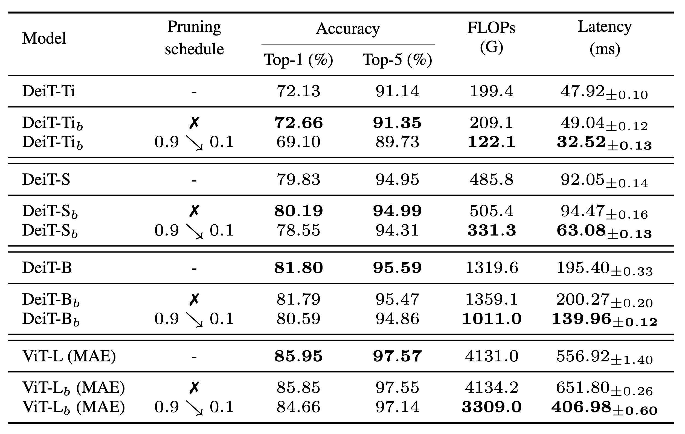

# Exploiting Biases in Attention for Transformers

<div align="center">
  
</div>
<div align="center">
  <b>Authors:</b> Charles Herr<sup>1</sup>, Gabriele Spadaro<sup>2</sup>, Enzo Tartaglione<sup>1, 3</sup>
</div>
<div align="center" style="margin-top: 8px;">
  <sup>1</sup> LTCI, Télécom Paris, Institut Polytechnique de Paris, France <br>
  <sup>2</sup> University of Turin, Italy &nbsp;&nbsp;
  <sup>3</sup> CNR-ISASI, Italy
</div>

## Overview

This repository contains the official implementation of the paper [Exploiting Biases in Attention for Transformers](https://arxiv.org/pdf/2611.04657). It builds on the official [DeiT](https://github.com/facebookresearch/deit) codebase. The main modifications concern the self-attention module, where we introduce the input-dependent bias and the bias-based column pruning.

## Abstract
Attention is known to be sparse in vision transformers. In particular, we analyze the unequal relevance of attention matrix columns to the final computation and show that this phenomenon becomes increasingly pronounced with network depth. This can be interpreted as saying that tokens have an absolute importance for the attention process, independently of queries. Inspired by this, we propose a reformulation of the attention formula that makes this phenomenon explicit by adding an input-dependent bias to the query-key dot product. We show that this new term gives each token a scalar value indicating its anticipated influence on other tokens during the attention process, and can thus serve as a proxy for pruning attention maps. Across multiple transformer model sizes, this allows us to substantially reduce the computational cost of attention, in terms of both FLOPs and inference latency, while retaining most of the original classification
accuracy.

## Usage

### Data
The directory structure should be the standard layout for the torchvision [`datasets.ImageFolder`](https://pytorch.org/docs/stable/torchvision/datasets.html#imagefolder), and the training and validation data is expected to be in the `train/` folder and `val` folder respectively:

```
/path/to/imagenet/
  train/
    class1/
      img1.jpeg
    class2/
      img2.jpeg
  val/
    class1/
      img3.jpeg
    class2/
      img4.jpeg
```

### Training

To train our DeiT-S<sub>b</sub> model on ImageNet-1k using 4 GPUs, run:

```bash
torchrun --nproc_per_node=4 src/main.py \
  --model deit_small_patch16_224 \
  --batch-size 256 \
  --data-path /path/to/imagenet \
  --output_dir /path/to/output \
  --resume https://dl.fbaipublicfiles.com/deit/deit_small_patch16_224-cd65a155.pth \
  --epochs 70 \
  --warmup-epochs 0 \
  --cooldown-epochs 5 \
  --lr 5e-5 \
  --min-lr 1e-6 \
  --unfreeze-attn-epoch 0 \
  --unfreeze-mlp-epoch 0 \
  --use-topk-bias
```

### Evaluation

To evaluate our DeiT-S<sub>b</sub> model on ImageNet-1k, run:

```bash
python src/main.py \
  --eval \
  --data-path /path/to/imagenet \
  --resume path/to/ckpt.pth \
  --model deit_small_patch16_224 \
  --use-topk-bias
```

### Latency and complexity

To measure inference latency and compute FLOPs:

```bash
python src/eval_complexity.py
```


## Results

### ImageNet-1k
<div>

</div>


## Acknowledgments

This work benefited from Hi! PARIS and State funding managed by the French National Research Agency (ANR) under the France 2030 program, reference ANR-23-IACL-0005. This work was also supported by the Italian MUR through the FIS 2 project FIS-2023-03417 (DD n. 23314 10-12-2024, CUP D53C25002040001) and by the DARE SGA1 project, which has received funding from the European High-Performance Computing Joint Undertaking (JU) under grant agreement No.101202459.

This repository is based on [DeiT](https://github.com/facebookresearch/deit). The original Apache 2.0 license and attribution are preserved (see `LICENSE`).

# Citation
If you use our code, please cite

```
    @inproceedings{herr2027attentionbias,
      title={{E}xploiting {B}iases in {A}ttention for {T}ransformers},
      author={Herr, Charles and Spadaro, Gabriele and Tartaglione, Enzo},
      booktitle = {Proceedings of the IEEE/CVF Winter Conference on Applications of Computer Vision (WACV)},
      year={2027}
    }
```
